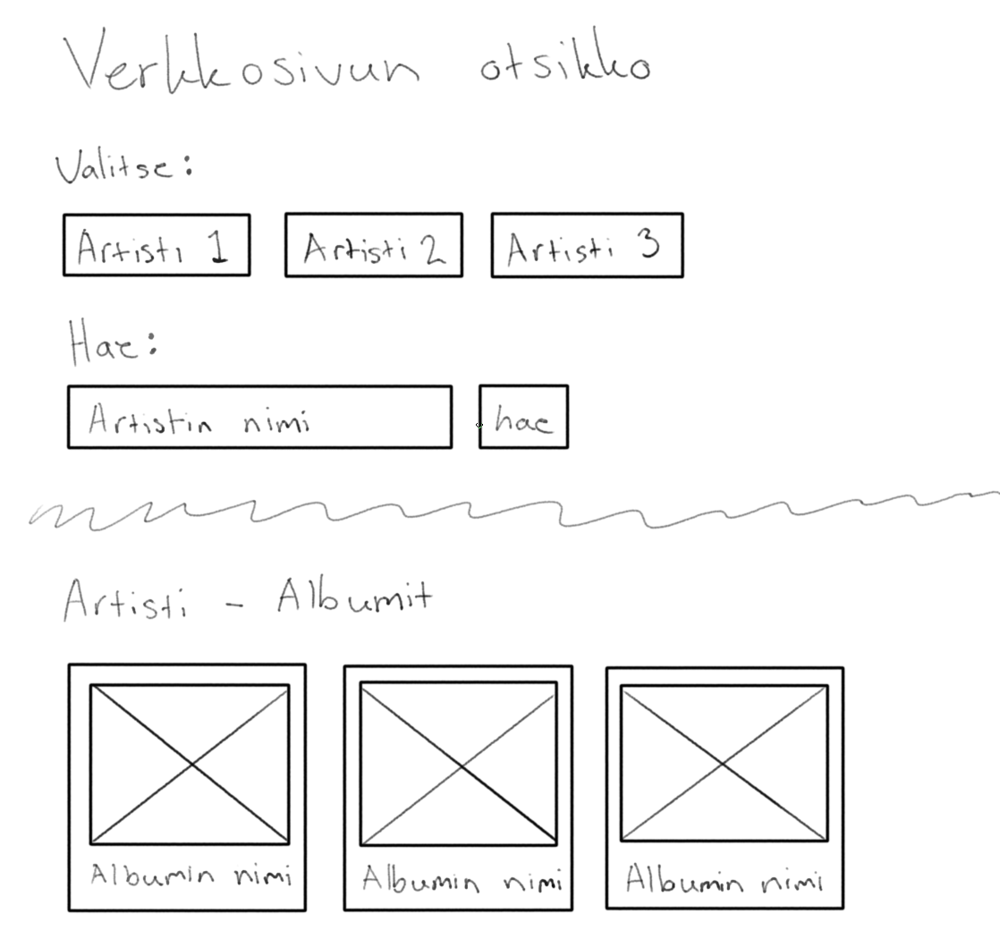
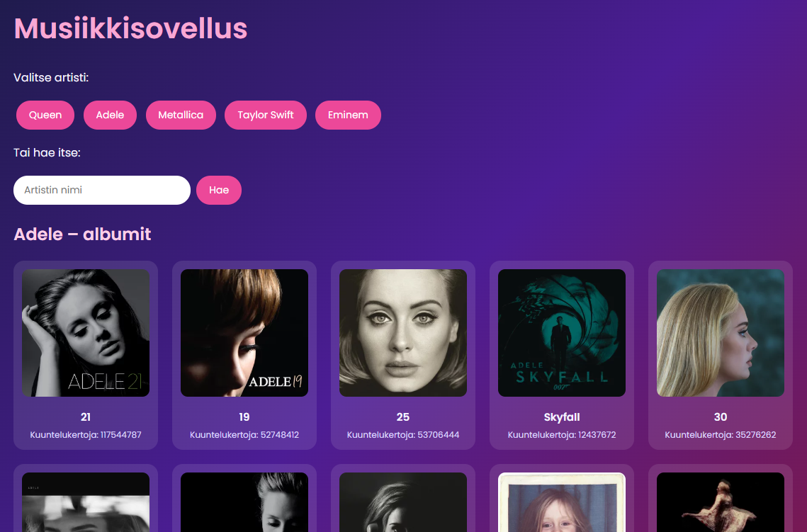
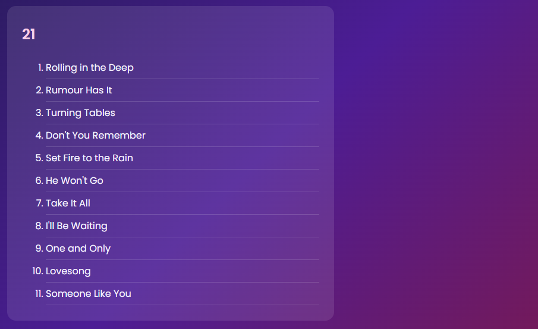

# Musiikkisovellus

**Tekijät:** Elina ja Ronja

## Projektisuunnitelma

### Projektin idea

Verkkosivu, jonka avulla käyttäjä voi tarkistaa eri artistien albumeilla olevat kappaleet.

### Suunnitellut toiminnot

- Toiminto 1: Artistin valinta ennalta määrätyistä vaihtoehdoista
- Toiminto 2: Toisena vaihtoehtona käyttäjä voi hakea itse valitsemansa artistin sekä virheilmoitus, mikäli haettua artistia ei löytynyt.
- Toiminto 3: Klikkaamalla albumia verkkosivu näyttää albumilla olevat kappaleet.

### Rautalankamalli / luonnos

## Verkkolinkit

- **Julkaistu sovellus:** [Projekti2_Musiikkisovellus](https://projekti2musiikkisovellus.netlify.app/)
- **GitHub-repositorio:** [Projekti2_Repository](https://github.com/Ayaynor/Projekti_2)

## Tietoja sovelluksesta

**[Musiikkisovellus]** on verkkosovellus, jonka avulla pääsee näkemään lempi artistiensa albumit, niiden kuuntelumäärän ja kappaleet. 

Käyttäjä voi kirjoittaa artistin nimen, jonka avulla pääsee näkemään kyseisen artistin kaikki albumit ja albumeilla olevat kappaleet.

Klikkaamalla albumia käyttäjä voi löytää uusia kappaleita artistilta, joista ei välttämättä ollut tietoinen entuudestaan.

## Teknologiat

- HTML – sivun rakenne
- CSS – ulkoasu ja asettelu
- JavaScript – toiminnallisuus, DOM-skriptaus, API-haut ja sisällön luominen sivulle dynaamisesti
- Last.fm API – artistien albumien ja kappaleiden tiedot
- Netlify Functions – API-avaimen piilottaminen, API-kutsut tehdään Netlifyn palvelimen kautta
- Netlify – sovelluksen julkaisu
- GitHub – versionhallinta ja yhteistyö parin kanssa

## Sovelluksen käyttö

1. Avaa sovellus linkistä -> https://projekti2musiikkisovellus.netlify.app/.
2. Klikkaa jotakin artistia tai kirjoita haluamasi artisti hakukenttään ja klikkaa "hae".
3. Alas tulee näkyviin kyseisen artistin albumit.
4. Albumia klikkaamalla verkkosivun alalaitaan tulee näkyviin kyseisen albumin kappaleet.

## Kuvakaappaukset

## Tunnetut virheet / puutteet

**Ei tunnettuja virheitä.**

## Työn jakautuminen

Projekti toteuttiin suhteellisen tiiviillä aikataululla, mutta siitä huolimatta yhteistyö sujui hienosti. Toteutus jakautui tasapuolisesti, sillä kaikki vaiheet tehtiin yhteistyöllä. 

- Tekijä 1: Elina Miasnikova
- Tekijä 2: Ronja Huotari

## Oma arvio ja oppimisen reflektointi

- Missä onnistuin? - API-avaimen hankkimisessa. Meidän mielestä toteutunut verkkosivu on kaikinpuolin onnistunut omien ja tehtävänannon mukaisten tavoitteiden mukaisesti (-video).
- Mikä oli haastavaa? - API-avaimen hankkiminen tuotti alustavasti haasteita, mutta siitäkin selvittiin.
- Mitä parantaisin, jos aikaa olisi enemmän? - Sivuston käytön puolesta olisi kiva, mikäli albumia klikatessa verkkosivu rullaisi suoraan alas kappaleisiin. Lisää hakusuodattimia.
- Mitä opin HTML:stä, CSS:stä, JavaScriptistä ja DOM-skriptauksesta? - Opittiin hakemaan dataa live-API:sta fetch-funktiolla ja käsittelemään vastauksen JSON-muodossa. Opittiin myös ettei API-avainta saa laittaa suoraan frontend-koodiin, ja opittiin piilottamaan se Netlify Functionsin ja ympäristömuuttujien avulla.
- Mikä jäi epäselväksi tai mistä haluaisin oppia lisää? - Ei tule mainittavaa mieleen.
- Oma arvio projektista: **8/10 pistettä**

## Lähteet ja kiitokset

- Kurssimateriaali
- [W3Schools](https://www.w3schools.com/)
- [MDN Web Docs](https://developer.mozilla.org/en-US/)
- [Google Fonts](https://fonts.google.com/)
- Kuvat:
  - Wireframet - Itse piirretty Krita sovelluksella ja piirtopöydällä.
  - Kuvakaappaukset omasta tekeleestä.
- Käytetty tekoälytyökalu: Copilot
  - Miten työkalua käytettiin: VS Coden sisällä käytetty kirjaamisen nopeuttamiseksi, kun ehdotus vastannut sitä mitä aiottu kirjata.
- Käytetty tekoälytyökalu: Gemini
  - Miten työkalua käytettiin: Ideoiminen.
- Käytetty tekoälytyökalu: Claude
  - Miten työkalua käytettiin: Koodin eheyden varmistaminen ja API-haasteiden kanssa avustaminen.

  ## Lisenssi

Tämä projekti on lisensoitu MIT-lisenssillä.

Lisätietoa lisenssin lisäämisestä GitHub-projektiin:
https://docs.github.com/en/communities/setting-up-your-project-for-healthy-contributions/adding-a-license-to-a-repository